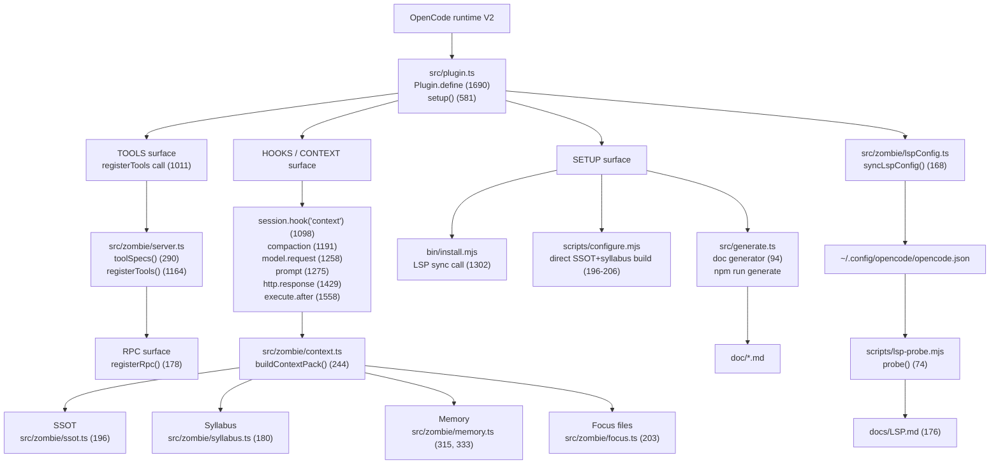

# ZombieCoder Architecture Map

একজন নতুন agent-এর জন্য এক পাতা: কোথা থেকে শুরু, কোন ফাইল কী করে, আর কোথায় হাত দিলে কী বদলায়। প্রতিটি `file:line` এই repo-তে `grep -n` দিয়ে যাচাই করা; না পারলে `UNVERIFIED` লেখা আছে।

> Snapshot: commit `9933ed7` (branch `murubbi`)। Line anchor code বদলালে সরে যেতে পারে — কাজ শুরুর আগে `grep -n` দিয়ে আবার মিলিয়ে নাও। Mermaid render এই environment-এ `NOT_TESTED` (block শুধু syntax-checked)।

## ১. Runtime chain



নোট: `src/generate.ts` persona বানায় না — এটি `doc/Identity Specification.md`, `doc/Agent Architecture.md` ইত্যাদি markdown generator (`src/generate.ts:94`, `package.json:17`)। Persona-র সত্যিকারের source `src/roster.ts`; runtime agent markdown লেখে `src/roster.ts:516` (`agentMarkdown`) আর `src/plugin.ts:581` (`setup`). LSP config-এর default path `~/.config/opencode/opencode.json` (`scripts/lsp-probe.mjs:41-46`); installer ওখানেই `lsp` block merge করে (`bin/install.mjs:1302`).

## ২. Tool map — ১৮টি tool

গণনা প্রমাণ: `toolSpecs()` runtime-এ `count=18` দেয় এবং `test/plugin.test.ts:272` `assert.equal(fake.tools.length, 18)` করে। নিচের প্রতিটি নাম `src/zombie/server.ts`-এর `name:` লাইন থেকে নেওয়া। Test column-এ `:139` = test "setup scaffolds .zombiecoder…", `:521` = test "context hook resolves…"; বাকি `file:line`-ও test declaration।

| # | Tool | কাজ (এক লাইন) | Impl `file:line` | Test | `plugin.ts` dep |
|---|---|---|---|---|---|
| 1 | `get_working_directory` | project root ও `.zombiecoder` layout দেখায় | `src/zombie/server.ts:295` | `test/plugin.test.ts:521` "context hook resolves…" | `projectRoot` |
| 2 | `read_ssot` | generated SSOT markdown পড়ে | `src/zombie/server.ts:310` | `test/plugin.test.ts:521` "context hook resolves…" | `projectRoot` |
| 3 | `read_syllabus` | append-only syllabus পড়ে | `src/zombie/server.ts:322` | `test/footprint.test.ts:20` (module only); tool call `UNVERIFIED` | `projectRoot` |
| 4 | `append_syllabus` | নতুন lesson append করে | `src/zombie/server.ts:334` | `test/plugin.test.ts:139` (indirect via goal_contract); tool call `UNVERIFIED` | `projectRoot` |
| 5 | `goal_contract` | কাজের আগে expected outcome লিখে রাখে; close-এ নিজেই check চালায় | `src/zombie/server.ts:349` | `test/plugin.test.ts:139`, `test/goalContract.test.ts:38` | `projectRoot` + optional `synthetic` |
| 6 | `project_fingerprint` | live project scan, কোনো file লেখে না | `src/zombie/server.ts:545` | `test/plugin.test.ts:139` | `projectRoot` |
| 7 | `context_status` | SSOT/syllabus/memory/focus pack-এর `uiLine` দেয় | `src/zombie/server.ts:551` | `test/plugin.test.ts:139`, `test/plugin.test.ts:521` | `projectRoot` + `storage` |
| 8 | `evidence_gate` | Python gate চালিয়ে claim PASS/FAIL যাচাই করে | `src/zombie/server.ts:587` | `test/plugin.test.ts:139` | `projectRoot` |
| 9 | `verify_real` | real input+artifact hash করে provenance লেখে | `src/zombie/server.ts:673` | `test/plugin.test.ts:139` | `projectRoot` |
| 10 | `memory_archive` | archived session message পড়ে | `src/zombie/server.ts:801` | `test/plugin.test.ts:139` (existence only); execution `UNVERIFIED` | `projectRoot` |
| 11 | `syntax_check` | LSP-shaped syntax fallback (LSP নয়) | `src/zombie/server.ts:823` | `test/lsp.test.ts:6` (module), `test/plugin.test.ts:139` (existence) | `—` |
| 12 | `skill_catalog` | shared skill list/install/auto | `src/zombie/server.ts:845` | `test/plugin.test.ts:139` (existence), `test/skillCatalog.test.ts:113` | `installRoot` + `reloadSkills` |
| 13 | `agent_modes` | V2 mode list + validated switch plan | `src/zombie/server.ts:877` | `test/plugin.test.ts:139` | `—` |
| 14 | `reload` | agents/skills/providers/tools door reload | `src/zombie/server.ts:904` | `test/tools.test.ts:54` | `reloadAgents/Skills/Providers/Tools` |
| 15 | `http_probe` | HTTP status/header/body hash, secret redact | `src/zombie/server.ts:941` | `test/tools.test.ts:68` | `—` |
| 16 | `patch_preview` | one exact-string replace dry-run; apply-এ backup | `src/zombie/server.ts:1006` | `test/tools.test.ts:89` | `projectRoot` |
| 17 | `env_get` | env var আছে কিনা, value ছাড়া | `src/zombie/server.ts:1065` | `test/tools.test.ts:125` | `—` |
| 18 | `service_probe` | TCP connect বা HTTP GET probe | `src/zombie/server.ts:1089` | `test/tools.test.ts:141` | `—` |

## ৩. কোথায় কী এডিট করব

| চাই | ফাইল | Anchor | কেন |
|---|---|---|---|
| Persona, shared rules, voice | `src/roster.ts` | `SHARED_RULES:36`, `SHARED_PERSONA:188` | সব agent-এর common instruction এখান থেকেই আসে |
| Agent-এর persona merge | `src/roster.ts` | `mergeAgentPersona:215` | agent-specific + shared block জোড়ে |
| Agent markdown render | `src/roster.ts` | `agentMarkdown:516` | runtime `.md` persona-র আসল generator |
| Agent config render | `src/roster.ts` | `renderAgentsConfig:303` | `opencode.json` agent block |
| Doc markdown generator | `src/generate.ts` | `main:94` | `doc/*.md` build artifact; persona নয় |
| SSOT | `src/zombie/ssot.ts` | `writeSsot:196` | live scan → `SSOT.md` |
| Syllabus | `src/zombie/syllabus.ts` | `appendSyllabus:180` | append-only lesson |
| Memory / archive | `src/zombie/memory.ts` | `archiveSessionSnapshot:315`, `readArchive:333` | session archive ও read |
| Context pack | `src/zombie/context.ts` | `buildContextPack:244` | bounded SSOT+syllabus+focus+memory |
| Focus file resolution | `src/zombie/focus.ts` | `resolveFocus:203` | user message → target files |
| Goal contract | `src/zombie/goalContract.ts` | `runCheck:215` | contract parse/match/check |
| Tools | `src/zombie/server.ts` | `toolSpecs:290` | ১৮টি tool-এর একমাত্র registry |
| Plugin wiring / hooks | `src/plugin.ts` | `setup:581`, `export default:1690` | surface registration ও hook lifecycle |
| Setup / install | `bin/install.mjs` | `renderAgentsConfig` call `:1224`, LSP sync `:1302` | global/project install |
| Project configure | `scripts/configure.mjs` | direct build `:196-206` | OpenCode বন্ধ থাকলেও SSOT+syllabus |
| LSP config | `src/zombie/lspConfig.ts` | `LSP_SERVERS:52`, `syncLspConfig:168` | server list + `opencode.json` merge |
| LSP probe | `scripts/lsp-probe.mjs` | `probe:74`, config read `:176` | real JSON-RPC initialize |
| Tests | `test/*.test.ts` | — | `npm test` (`package.json:19`) |
| Docs | `docs/*.md` | — | LSP: `docs/LSP.md:176`; handoff: `docs/AGENT-HANDOFF.md:23` |

## ৪. Agent flow — পড়া থেকে প্রমাণ

1. **SSOT** — `read_ssot`; project structure ও shared rules আগে দেখো।
2. **Syllabus** — `read_syllabus`; আগের lesson ও footprint বাদ দিও না।
3. **Memory** — দরকার হলে `memory_archive`; পুরো history টানো নিষেধ।
4. **Focus** — `context_status`-এ `message` দাও; `src/zombie/focus.ts:203` target file list দেয়।
5. **Act** — নির্দিষ্ট file/symbol পড়ে smallest correct diff; irreversible কাজের আগে backup (`patch_preview:1006`)।
6. **Verify** — আসল command/output; `evidence_gate:587` বা `verify_real:673`; `goal_contract close:349` নিজেই check চালায়, agent-এর exitCode claim বিশ্বাস করে না।

| Gate | কোথায় | কখন |
|---|---|---|
| `goal_contract` | `src/zombie/server.ts:349` | প্রথম write/edit-এর আগে `open`; শেষে `close` |
| `context_status` | `src/zombie/server.ts:551` | substantive কাজের শুরুর দৃশ্যমান লাইন |
| Pre-work gate text | `src/zombie/context.ts:322` | pack-এ inject হওয়া gate instruction |
| Response gate | `src/plugin.ts:1429` | `http.response` hook, unproven claim আটকায় |
| Tool failure breaker | `src/plugin.ts:1558` | `execute.after`, তিন failure-এ escalation |

## ৫. Known boundaries

| Boundary | সত্যি অবস্থা | প্রমাণ |
|---|---|---|
| `usage_report` | implement করা নেই; `src/`, `test/`, `docs/`, installer-এ নামও নেই (এই map বাদে) | `grep -rn "usage_report" src docs test bin scripts README.md --exclude=architecture-map.md \| wc -l` → 0 |
| `eval_run` | implement করা নেই; `src/`, `test/`, `docs/`, installer-এ নামও নেই (এই map বাদে) | `grep -rn "eval_run" src docs test bin scripts README.md --exclude=architecture-map.md \| wc -l` → 0 |
| Editor LSP diagnostics | `NOT_TESTED` — app restart + real `.ts` file open + `ps`-এ LSP child দেখা, তারপর `END_TO_END_TESTED` | `docs/LSP.md:224` |
| LSP direct probe | এই session-এ `npm run lsp:probe -- --compact --root "$PWD"` → exit 0, 7/7 server `ok: true` (`LIVE_PROBE_PASSED`); editor diagnostic আলাদা স্তর | `scripts/lsp-probe.mjs:74`, `docs/LSP.md:176` |
| `syntax_check` | LSP নয়; `node --check`, `tsc`, `py_compile`, `bash -n`, `php -l` fallback | `docs/LSP.md:247`, `src/zombie/lsp.ts:328` |

## ৬. Machine-readable

```yaml
# impl = spec `name:` line in src/zombie/server.ts
tools:
  get_working_directory: { impl: "src/zombie/server.ts:295", tests: ["test/plugin.test.ts:521"], docs: ["README.md:823"] }
  read_ssot:             { impl: "src/zombie/server.ts:310", tests: ["test/plugin.test.ts:521"], docs: ["README.md:821"] }
  read_syllabus:         { impl: "src/zombie/server.ts:322", tests: ["test/footprint.test.ts:20"], docs: ["README.md:822"] }
  append_syllabus:       { impl: "src/zombie/server.ts:334", tests: ["test/plugin.test.ts:139"], docs: ["README.md:828"] }
  goal_contract:         { impl: "src/zombie/server.ts:349", tests: ["test/plugin.test.ts:139", "test/goalContract.test.ts:38"], docs: ["docs/AGENT-HANDOFF.md:23"] }
  project_fingerprint:   { impl: "src/zombie/server.ts:545", tests: ["test/plugin.test.ts:139"], docs: ["README.md:824"] }
  context_status:        { impl: "src/zombie/server.ts:551", tests: ["test/plugin.test.ts:139", "test/plugin.test.ts:521"], docs: ["README.md:825"] }
  evidence_gate:         { impl: "src/zombie/server.ts:587", tests: ["test/plugin.test.ts:139"], docs: ["README.md:826"] }
  verify_real:           { impl: "src/zombie/server.ts:673", tests: ["test/plugin.test.ts:139"], docs: [] }
  memory_archive:        { impl: "src/zombie/server.ts:801", tests: ["test/plugin.test.ts:139"], docs: ["README.md:827"] }
  syntax_check:          { impl: "src/zombie/server.ts:823", tests: ["test/lsp.test.ts:6", "test/plugin.test.ts:139"], docs: ["README.md:829", "docs/LSP.md:247"] }
  skill_catalog:         { impl: "src/zombie/server.ts:845", tests: ["test/plugin.test.ts:139", "test/skillCatalog.test.ts:113"], docs: ["README.md:830"] }
  agent_modes:           { impl: "src/zombie/server.ts:877", tests: ["test/plugin.test.ts:139"], docs: [] }
  reload:                { impl: "src/zombie/server.ts:904", tests: ["test/tools.test.ts:54"], docs: [] }
  http_probe:            { impl: "src/zombie/server.ts:941", tests: ["test/tools.test.ts:68"], docs: [] }
  patch_preview:         { impl: "src/zombie/server.ts:1006", tests: ["test/tools.test.ts:89"], docs: [] }
  env_get:               { impl: "src/zombie/server.ts:1065", tests: ["test/tools.test.ts:125"], docs: [] }
  service_probe:         { impl: "src/zombie/server.ts:1089", tests: ["test/tools.test.ts:141"], docs: [] }
```

`docs: []` মানে dedicated doc section নেই; source description-ই তখন documentation।
